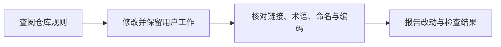

**Email:** bojue.math@gmail.com\
**Version:** 1.0.0\
**Last Updated:** 2026-11-28 00:32:05

# Agent instructions

## Scope

These instructions apply throughout this repository unless a more specific instruction is explicitly established.

## Maintenance rules

1. Before structural changes, read [README.md](README.md), [ARCHITECTURE.md](ARCHITECTURE.md), and [SPECIFICATION.md](SPECIFICATION.md). Read [README__agents.md](README__agents.md) for project context and navigation before working in this repository. Operational instructions are established here and in applicable scoped agent instructions.
2. Use established terminology where available. Distinguish standard definitions, common conventions, and repository-defined rules. Do not invent citations or call local rules international standards.
3. Keep English identifiers canonical; provide concise Chinese equivalents for glossary terms. Use consistent spelling and link related concepts rather than duplicate definitions.
4. Use the templates for new entries and protocols; add substantial information rather than empty placeholders.
5. Follow the naming and versioning protocols. External ecosystem conventions take precedence where required.
6. Preserve existing user work. Do not rename/delete large sets of files, overwrite unrelated changes, commit, publish, or push without authorization.
7. For changes, check internal relative links, consistency of terms, naming, and UTF-8 text. Report modified paths, checks performed, and unresolved decisions. Do not claim checks that were not run.
8. Follow the [document layout](SPECIFICATION.md#document-layout). Put the fixed `Email` (`bojue.math@gmail.com`), the `MAJOR.MINOR.PATCH` `Version`, and the actual local modification date and time (`Last Updated`, `YYYY-MM-DD HH:mm:ss`) above the title in that order. Apply the [document revision rules](protocols/versioning.md#document-revision-version) on update. Replace date and time placeholders when copying templates.

## 维护流程

