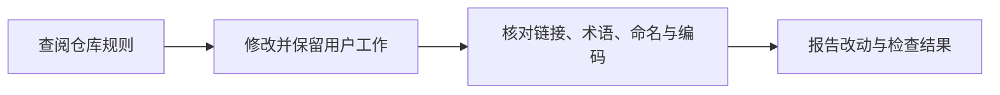

# Agent instructions

## Scope

These instructions apply throughout this repository unless a more specific instruction is explicitly established.

## Maintenance rules

1. Read `README.md`, `ARCHITECTURE.md`, and `SPECIFICATION.md` before structural changes.
2. Use established terminology where available. Distinguish standard definitions, common conventions, and repository-defined rules. Do not invent citations or call local rules international standards.
3. Keep English identifiers canonical; provide concise Chinese equivalents for glossary terms. Use consistent spelling and link related concepts rather than duplicate definitions.
4. Use the templates for new entries and protocols; add substantial information rather than empty placeholders.
5. Follow the naming and versioning protocols. External ecosystem conventions take precedence where required.
6. Preserve existing user work. Do not rename/delete large sets of files, overwrite unrelated changes, commit, publish, or push without authorization.
7. For changes, check internal relative links, consistency of terms, naming, and UTF-8 text. Report modified paths, checks performed, and unresolved decisions. Do not claim checks that were not run.

## 维护流程

