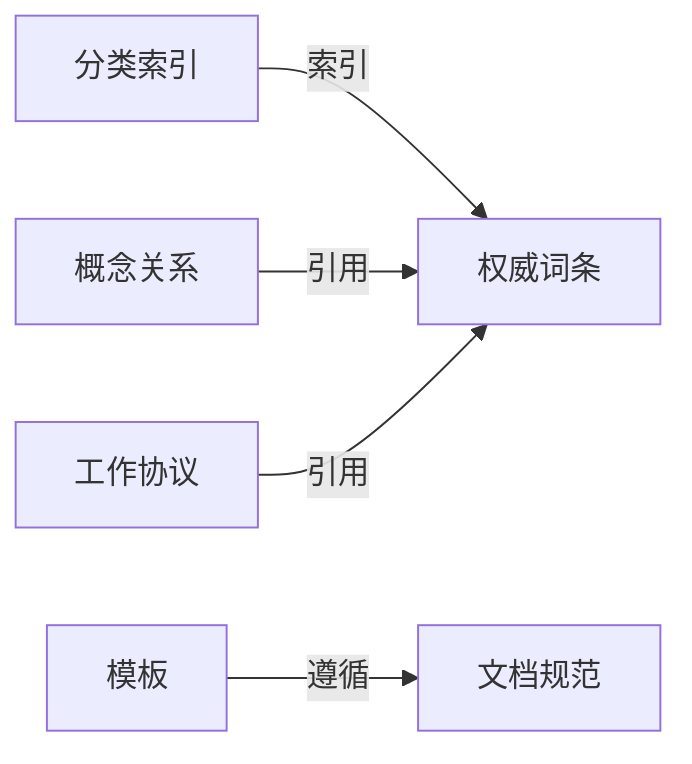

# `Architecture`

- [`dictionary/`](dictionary/) 保存权威定义、分类索引和关系。一个概念只定义一次，其他文档链接到词条。
- [`protocols/`](protocols/) 保存工作规则。[`templates/`](templates/) 保存对应的可复制格式。
- 根目录负责导航、维护与发布。实际用例或工具有明确需求时再独立存放。

移动词条时更新引用。词条与协议格式见 [`Specification`](SPECIFICATION.md)。
