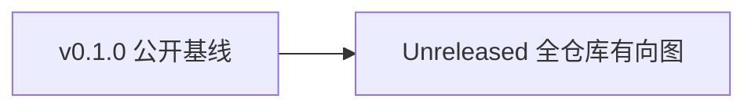

# Changelog

## `v0.1.0`

- Initialize bilingual core terminology and repository governance.
- Introduce proposed file naming, directory naming, and versioning protocols.
- Add templates for future entries and protocols.

- 整合跨领域核心词条、分类及显式语义关系。
- 补充资源命名约定，统一模板并记录基线核查结果。

## `Unreleased`

- 从首页到各文档统一有向图，并补齐全部术语的分类图。

