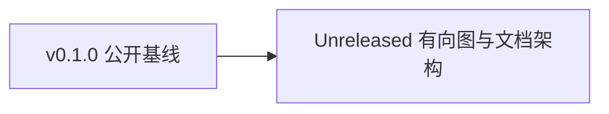

**Email:** bojue.math@gmail.com\
**Version:** 1.0.0\
**Last Updated:** 2026-11-28 00

# Changelog

## `v0.1.0`

- Initialize bilingual core terminology and repository governance.
- Introduce proposed file naming, directory naming, and versioning protocols.
- Add templates for future entries and protocols.

- 整合跨领域核心词条、分类及显式语义关系。
- 补充资源命名约定，统一模板并记录基线核查结果。

## `Unreleased`

- 文档页首的 `Last Updated` 改为记录当地日期和小时，修订版本继续按日期递增。

- 引入面向受众的文档架构、智能体上下文入口及配套命名约定，补充相关术语和核查记录。
- 从首页到各文档统一有向图，并补齐全部术语的分类图。

