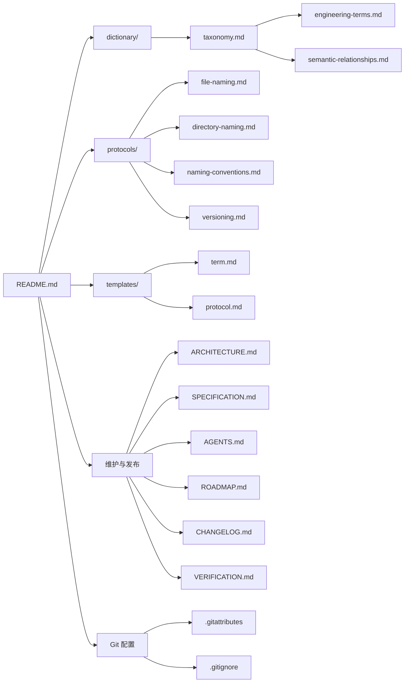

# Engineering Dictionary

工程协作速查。用它查术语、给工作产物命名、记录验收证据。

## 仓库总览

箭头表示导航入口，连到同一层的分支可按任务选择。图例见[有向图约定](SPECIFICATION.md#directed-diagrams)。

## 开始工作

1. **对齐需求。** 先写清楚要交付什么，以及什么条件算通过。[`Requirement`](dictionary/engineering-terms.md#requirement) · [`Acceptance criterion`](dictionary/engineering-terms.md#acceptance-criterion)
2. **给产物命名。** 如 `experiments/001/results.csv`，目录说明实验编号，文件说明内容。[命名示例教学](protocols/naming-conventions.md#naming-by-example) · [文件命名](protocols/file-naming.md) · [目录命名](protocols/directory-naming.md)
3. **验收并留证。** 例如，要求每个交易日恰好一条记录，就核对日期集合并检查重复值，保存检查结果。[`Verification`](dictionary/engineering-terms.md#verification) · [`Evidence`](dictionary/engineering-terms.md#evidence)

## 速查

- **查或补术语**　[全部术语图](dictionary/taxonomy.md) · [完整词典](dictionary/engineering-terms.md) · [跨类别关系](dictionary/semantic-relationships.md) · [词条模板](templates/term.md)
- **统一团队约定**　[资源命名](protocols/naming-conventions.md) · [版本管理](protocols/versioning.md) · [协议模板](templates/protocol.md)

维护与发布

[架构](ARCHITECTURE.md) · [规范](SPECIFICATION.md) · [维护规则](AGENTS.md) · [路线图](ROADMAP.md) · [变更日志](CHANGELOG.md) · [基线核查](VERIFICATION.md)

`v0.1.0` 是初始公开基线。协议状态见各自文档。项目尚未授予再利用许可证。

