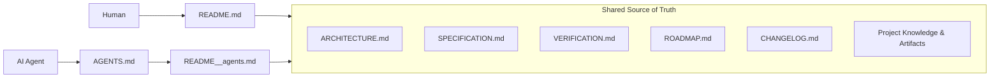

**Email:** bojue.math@gmail.com\
**Version:** 1.0.0\
**Last Updated:** 2026-11-28 00

# Engineering Dictionary

工程协作速查。用它查术语、给工作产物命名、记录验收证据。

箭头表示阅读与导航。智能体从 [AGENTS.md](AGENTS.md) 进入[项目上下文](README__agents.md)。共享资料包括[架构](ARCHITECTURE.md)、[规范](SPECIFICATION.md)、[验证证据](VERIFICATION.md)、[路线图](ROADMAP.md)、[变更日志](CHANGELOG.md)和下方的术语与协议。

## 开始工作

1. **对齐需求。** 先写清楚要交付什么，以及什么条件算通过。[`Requirement`](dictionary/engineering-terms.md#requirement) · [`Acceptance criterion`](dictionary/engineering-terms.md#acceptance-criterion)
2. **给产物命名。** 如 `experiments/001/results.csv`，目录说明实验编号，文件说明内容。[命名示例教学](protocols/naming-conventions.md#naming-by-example) · [文件命名](protocols/file-naming.md) · [目录命名](protocols/directory-naming.md)
3. **验收并留证。** 例如，要求每个交易日恰好一条记录，就核对日期集合并检查重复值，保存检查结果。[`Verification`](dictionary/engineering-terms.md#verification) · [`Evidence`](dictionary/engineering-terms.md#evidence)

## 速查

- **查或补术语**　[全部术语图](dictionary/taxonomy.md) · [完整词典](dictionary/engineering-terms.md) · [跨类别关系](dictionary/semantic-relationships.md) · [词条模板](templates/term.md)
- **统一团队约定**　[资源命名](protocols/naming-conventions.md) · [版本管理](protocols/versioning.md) · [协议模板](templates/protocol.md) · [文档架构协议](protocols/documentation-architecture.md)
