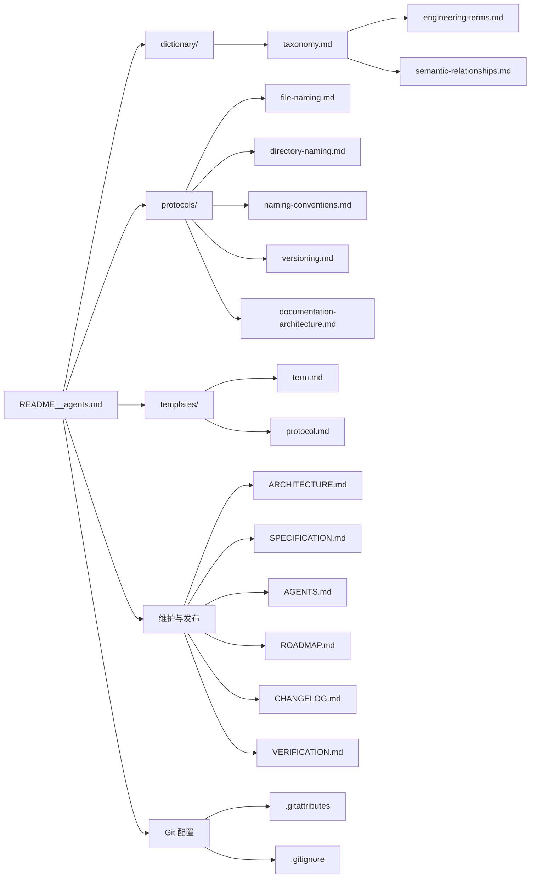

**Email:** bojue.math@gmail.com\
**Version:** 1.0.0\
**Last Updated:** 2026-11-28 00

# Engineering Dictionary for AI agents

本仓库为工程协作与研究提供双语术语、资源命名与版本协议，以及记录验收证据时可复用的结构。本文提供项目上下文和查找路径。操作要求见 [AGENTS.md](AGENTS.md)。

## 建议阅读顺序

1. 从 [README.md](README.md) 了解项目用途，再看[架构](ARCHITECTURE.md)和[规范](SPECIFICATION.md)。
2. 从[分类索引](dictionary/taxonomy.md)找到权威词条。以[术语表](dictionary/engineering-terms.md)中的英文标题和中文定义为准，通过[语义关系](dictionary/semantic-relationships.md)理解关联概念。
3. 按任务查[文件](protocols/file-naming.md)、[目录](protocols/directory-naming.md)、[资源命名](protocols/naming-conventions.md)、[版本](protocols/versioning.md)或[文档架构](protocols/documentation-architecture.md)协议。新增内容可从[词条模板](templates/term.md)和[协议模板](templates/protocol.md)起步。
4. 从[核查记录](VERIFICATION.md)区分已验证的证据和核查范围。用[路线图](ROADMAP.md)了解计划，用[变更日志](CHANGELOG.md)定位已记录的变动。

## 常用术语

把[需求](dictionary/engineering-terms.md#requirement)落实为可观察的[验收条件](dictionary/engineering-terms.md#acceptance-criterion)。核查时把[验证](dictionary/engineering-terms.md#verification)结果与[证据](dictionary/engineering-terms.md#evidence)关联起来。阅读文档时区分[受众](dictionary/engineering-terms.md#audience)、[上下文](dictionary/engineering-terms.md#context)和[指令](dictionary/engineering-terms.md#instruction)。

## 仓库总览

箭头表示导航入口，连到同一层的分支可按任务选择。图例见[有向图约定](SPECIFICATION.md#directed-diagrams)。

## 当前状态与限制

初始公开基线、待发布改动及协议状态分别见[变更日志](CHANGELOG.md)和各协议的状态字段。真实任务试用、采用决定、许可证、兼容性承诺与维护职责仍见[路线图](ROADMAP.md)。已有证据及其覆盖边界见[核查记录](VERIFICATION.md)。
