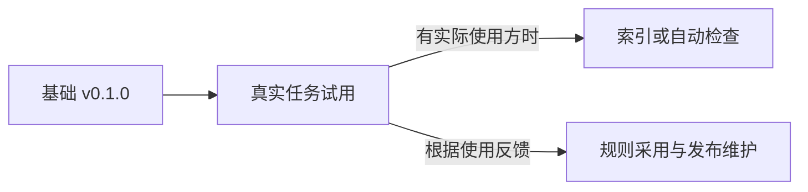

**Email:** bojue.math@gmail.com\
**Version:** 1.0.0\
**Last Updated:** 2026-11-28 00

# `Roadmap`

1. **基础**　`v0.1.0` 已发布。术语、索引和命名约定可用。[基线核查](VERIFICATION.md)
2. **应用**　在至少两个真实工程任务中试用。把反复遇到的问题整理成可复用示例。在试用中验证人类与智能体能否沿各自入口找到相同的权威资料，再决定是否采用[文档架构协议](protocols/documentation-architecture.md)。
3. **工具**　有实际使用方时，再从现有 `Markdown` 生成索引或增加自动检查。
4. **维护**　确定后续发布的许可证、兼容性承诺和维护职责。按使用反馈决定哪些拟议规则正式采用。
