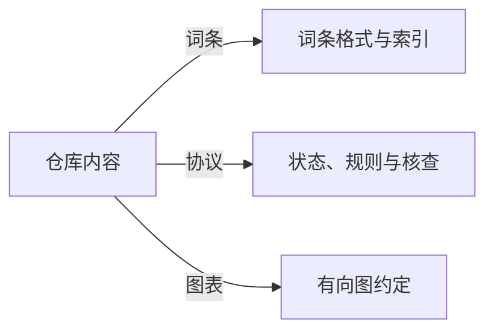

**Email:** bojue.math@gmail.com\
**Version:** 1.0.0\
**Last Updated:** 2026-11-28

# `Specification`

`Status` `Proposed`

## `Requirements`



### `Dictionary entries`

每个概念只有一个权威词条。依次写英文二级标题、`Chinese equivalent` 和中文定义，并在分类索引登记一次。用 `Related terms` 链接有用的关联。显式关系使用约定的名称和方向。[词条模板](templates/term.md) · [分类索引](dictionary/taxonomy.md) · [关系](dictionary/semantic-relationships.md)

### `Protocols`

按模板记录状态、范围、规则、例外、示例和核查方式。维护者审核后可由 `Proposed` 改为 `Adopted`。标为 `Deprecated` 时说明原因，附上已有的替代方案。[协议模板](templates/protocol.md)

### `Repository content`

引用外部标准时注明来源。文本用 `UTF-8`，内部链接用大小写准确的相对路径。命名遵循协议及其例外。提交前实际核对链接、编码和命名。[文件命名](protocols/file-naming.md) · [目录命名](protocols/directory-naming.md)

### `Directed diagrams`

- 使用 `Mermaid flowchart`。默认从左向右阅读。节点使用现有术语、文件名或步骤名。
- 实线箭头从来源指向目标。按图的用途标明归属、导航、步骤或语义关系。同一来源下的分支表示并列。平行对照使用无箭头虚线。
- 分类、定义和规则以正文为准。图旁保留普通链接供查阅全文。图表改动需核对节点、箭头方向和对应链接。

### `Document layout`

本仓库的 Markdown 文档在标题之前的左上角依次放置以下三行，加粗字段名。分页输出在每页左上角重复相同的页首。合并到术语表的词条沿用术语表的页首。

```markdown
**Email:** bojue.math@gmail.com\
**Version:** 1.0.0\
**Last Updated:** YYYY-MM-DD
```

- `Email` 固定为 `bojue.math@gmail.com`。
- `Version` 使用语义化版本的 `MAJOR.MINOR.PATCH` 数字格式，从 `1.0.0` 开始。各字段按本仓库的[文档修订版本规则](protocols/versioning.md#document-revision-version)递增。
- `Last Updated` 记录文档实际最后修改的当地日期，采用 ISO 8601 格式 `YYYY-MM-DD`。复制模板时，将日期占位符替换为实际日期。

### `Audience-oriented documentation architecture`

为智能体提供独立项目上下文有实际价值时，可采用此模式。小型仓库可把背景保留在普通 README 中。复杂仓库可在上下文文档中链接到子系统各自的权威资料，并通过适用的作用域指令管理操作规则。本仓库对采用的模式作如下约定。

| 文档 | 受众 | 职责与信息所有权 |
| --- | --- | --- |
| [README.md](README.md) | 人类 | 项目描述与常用导航 |
| [README__agents.md](README__agents.md) | 智能体 | 理解项目所需的背景、术语入口与阅读顺序 |
| [AGENTS.md](AGENTS.md) | 智能体 | 必须或允许执行的操作、约束与必读资料 |
| [ARCHITECTURE.md](ARCHITECTURE.md) | 共享 | 结构、组成和导航关系 |
| [SPECIFICATION.md](SPECIFICATION.md) | 共享 | 实现必须满足的要求与约束 |
| [VERIFICATION.md](VERIFICATION.md) | 共享 | 核查结果及支持结论的证据 |
| [ROADMAP.md](ROADMAP.md) | 共享 | 计划与待决事项 |
| [CHANGELOG.md](CHANGELOG.md) | 共享 | 已记录的变更 |

- 首页在简介后放置阅读路径图和普通链接。箭头表示导航。智能体入口必须直接链接上下文文档，上下文与首页均应提供共享来源的入口。
- 独立上下文采用精确拼写的 `README__agents.md`，参见[文件命名例外](protocols/file-naming.md#exceptions)。
- 每项定义、规则或证据由其负责的文档维护。其他文档用简短摘要和相对链接引用。修改时核对相关摘要、链接和证据，避免多处文本产生不同结论。
- 核查文件名、角色边界、智能体入口、链接及锚点、图的语法与导航方向，以及结论能否追溯到证据。记录检查方式、结果和覆盖限制。[文档架构协议](protocols/documentation-architecture.md)
