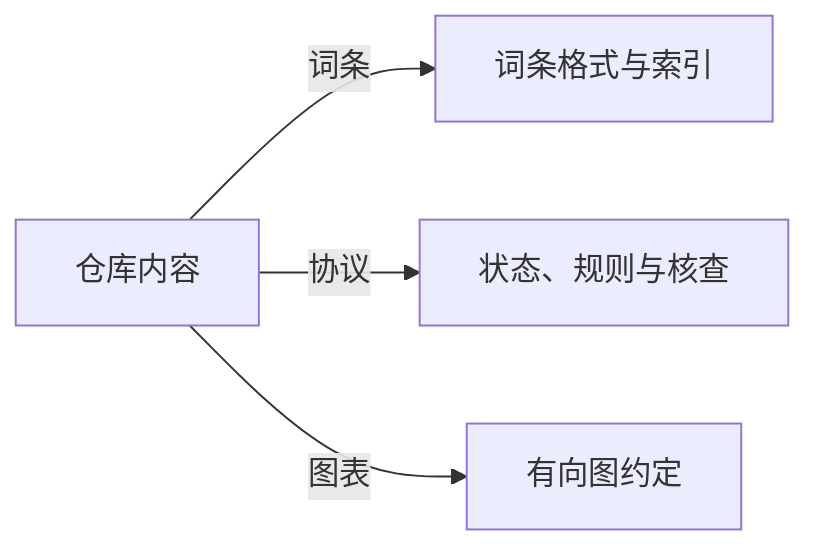

# `Specification`

`Status` `Proposed`

## `Requirements`

### `Dictionary entries`

每个概念只有一个权威词条。依次写英文二级标题、`Chinese equivalent` 和中文定义，并在分类索引登记一次。用 `Related terms` 链接有用的关联。显式关系使用约定的名称和方向。[词条模板](templates/term.md) · [分类索引](dictionary/taxonomy.md) · [关系](dictionary/semantic-relationships.md)

### `Protocols`

按模板记录状态、范围、规则、例外、示例和核查方式。维护者审核后可由 `Proposed` 改为 `Adopted`。标为 `Deprecated` 时说明原因，附上已有的替代方案。[协议模板](templates/protocol.md)

### `Repository content`

引用外部标准时注明来源。文本用 `UTF-8`，内部链接用大小写准确的相对路径。命名遵循协议及其例外。提交前实际核对链接、编码和命名。[文件命名](protocols/file-naming.md) · [目录命名](protocols/directory-naming.md)

### `Directed diagrams`

- 使用 `Mermaid flowchart`。默认从左向右阅读。节点使用现有术语、文件名或步骤名。
- 实线箭头从来源指向目标。按图的用途标明归属、导航、步骤或语义关系。同一来源下的分支表示并列。平行对照使用无箭头虚线。
- 分类、定义和规则以正文为准。图旁保留普通链接供查阅全文。图表改动需核对节点、箭头方向和对应链接。
