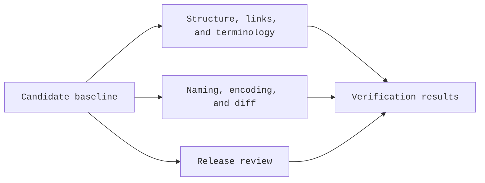

# `Verification report`

- `Date`：`2026-11-26`
- `Scope`：`v0.1.0` 基线及随其公开的现有历史

| `Check` | `Result` |
| --- | --- |
| `Repository structure` | 实际目录树与架构文档一致。检查 18 个文件和 3 个子目录，包含 4 份协议和 2 份模板。 |
| `Links and rendering` | 使用本地 `VS Code` 的 `Markdown` 渲染器检查 16 份文档。187 个内部链接均可按目标大小写解析，其中 143 个带标题锚点。首页的 15 个链接覆盖其余全部文档。 |
| `Terminology and taxonomy` | 58 个词条均有唯一的英文标题、中文对应词和中文定义，各归入 5 个类别之一。核查两个显式关系的标签和目标。 |
| `Naming` | 实际路径通过字面规则、根目录例外、大小写冲突和保留名称检查。8 个文件名、6 个目录名的正反样例符合预期。 |
| `Encoding and diff` | 18 个文件通过严格 `UTF-8` 解码和 `LF` 检查。`git diff --check` 通过。 |
| `Release review` | 审查现有提交和候选文件。凭据和机器路径的模式扫描无匹配。历史提交的作者元数据含机构邮箱，公开该邮箱需维护者确认。 |

本地结构核查通过。渲染和命名核查分别限于本地预览和静态规则。模式扫描无法证明不存在所有形式的敏感信息。远程可见性、匿名访问和发布页需在发布后核查。后续许可与兼容性决策见路线图。

## `Directed diagram checks`

本地解析 16 份文档中的 20 张图。首页总览覆盖 18 个受版本控制的文件，五张分类图覆盖 58 个术语。187 个内部链接通过解析，其中 147 个指向标题锚点。图表核查覆盖语法及节点，视觉布局以实际预览为准。
