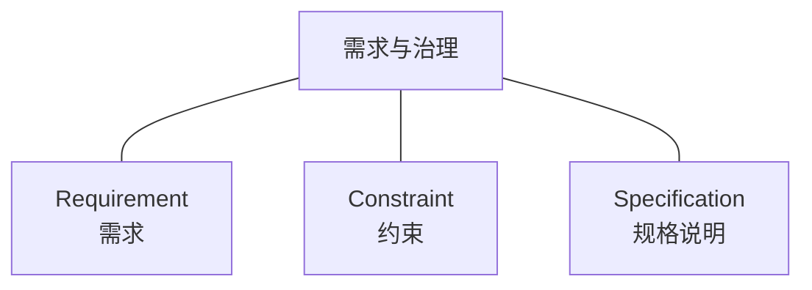
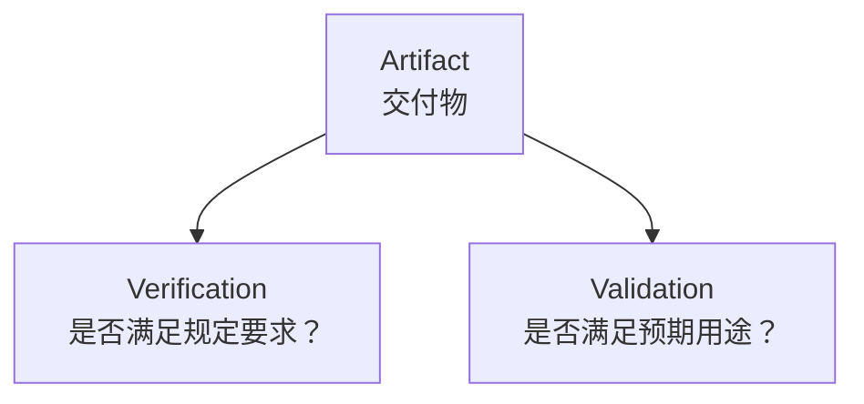

# `Semantic relationships`

## 并列关系

同属一个类别的词条并列摆放。以下摘取「需求与治理」中的三个词条，完整归属见[分类索引](taxonomy.md)。

## 平行关系

围绕同一交付物，可以从两个角度分别检查。图中两条线表示不同的判断依据，实际先后由任务决定。[`Verification`](engineering-terms.md#verification) · [`Validation`](engineering-terms.md#validation)

## 具体关系

并列和平行用于看结构。需要说明依赖、组成或验证对象时，使用下表的具体关系，按 `Source → Target` 读取。

| `Relation` | 类型 | 方向与含义 | 示例 |
| --- | --- | --- | --- |
| `is-a` | 分类 | 特化概念 → 更一般的概念 | [`Subsystem`](engineering-terms.md#subsystem) → [`System`](engineering-terms.md#system) |
| `part-of` | 组成 | 部分 → 整体 | [`Component`](engineering-terms.md#component) → [`System`](engineering-terms.md#system) |
| `depends-on` | 依赖 | 依赖方 → 所需条件或资源 | 运行中的程序 → 所需的[`Runtime`](engineering-terms.md#runtime) |
| `implements` | 实现 | 实现 → 所落实的要求或规格 | [`Implementation`](engineering-terms.md#implementation) → [`Specification`](engineering-terms.md#specification) |
| `produces` | 产出 | 活动 → 所产出的记录或产物 | [`Measurement`](engineering-terms.md#measurement) → 用作[`Evidence`](engineering-terms.md#evidence)的测量记录 |
| `verifies` | 核查 | 核查活动 → 被核查的规定要求 | [`Verification`](engineering-terms.md#verification) → [`Requirement`](engineering-terms.md#requirement) |
| `related-to` | 关联 | 两个概念之间有便于导航的关联，可双向阅读 | [`Version`](engineering-terms.md#version) ↔ [`Release`](engineering-terms.md#release) |

同一对象可以同时体现不同关系。子系统在类型上属于系统，在具体构造中又可以是较大系统的一部分。词条之间的双向导航只表示关联，关系方向以显式标签为准。

显式关系写作独立段落，格式为行内代码关系名加目标词条链接。普通 `Related terms` 段落用于导航。保留可阅读的 `Markdown` 链接，当前阶段采用此表示法记录关系。
