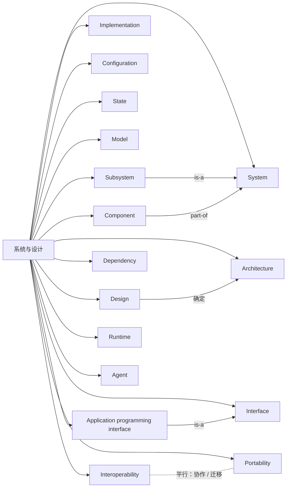
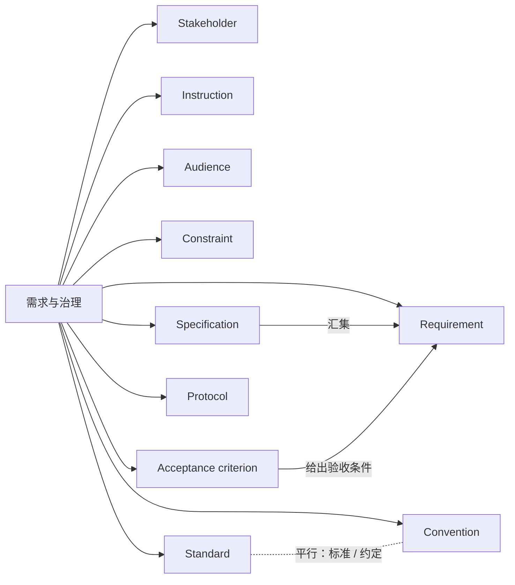
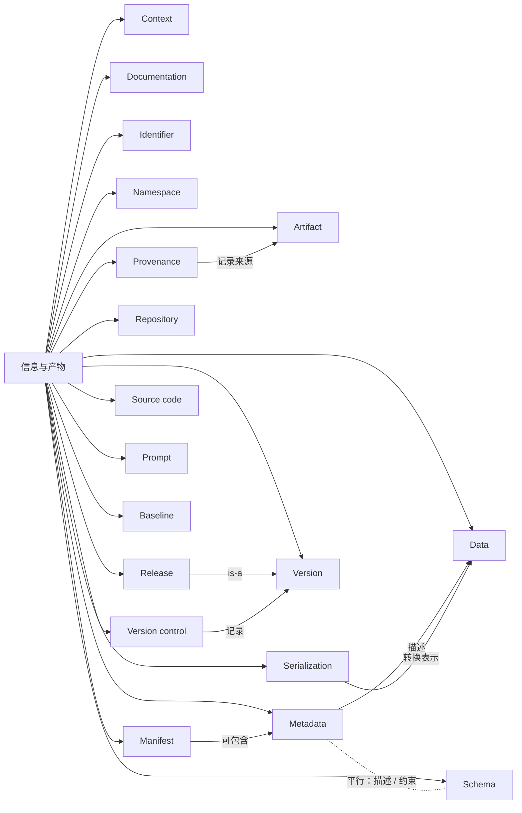
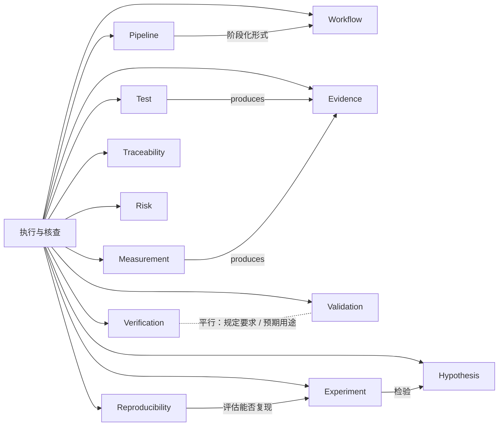
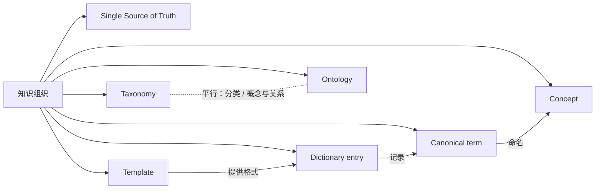

**Email:** bojue.math@gmail.com\
**Version:** 1.0.0\
**Last Updated:** 2026-11-28 00

# `Engineering taxonomy`

- **并列**：从同一个类别发出的箭头表示分类归属。每个词条只归入一类。
- **平行**：虚线连接可以从不同角度对照的概念。
- **有向关系**：词条之间带标签的箭头按起点到终点阅读。跨类别关系见[术语关系图](semantic-relationships.md)。

## `Systems and design`

系统的组成、边界、表示及交互能力。

打开词条链接

- [`System`](engineering-terms.md#system)
- [`Component`](engineering-terms.md#component)
- [`Architecture`](engineering-terms.md#architecture)
- [`Interface`](engineering-terms.md#interface)
- [`Implementation`](engineering-terms.md#implementation)
- [`Configuration`](engineering-terms.md#configuration)
- [`State`](engineering-terms.md#state)
- [`Model`](engineering-terms.md#model)
- [`Interoperability`](engineering-terms.md#interoperability)
- [`Portability`](engineering-terms.md#portability)
- [`Subsystem`](engineering-terms.md#subsystem)
- [`Design`](engineering-terms.md#design)
- [`Dependency`](engineering-terms.md#dependency)
- [`Application programming interface`](engineering-terms.md#application-programming-interface)
- [`Runtime`](engineering-terms.md#runtime)
- [`Agent`](engineering-terms.md#agent)

## `Requirements and governance`

工程工作所依据的需求、约束和规则。

打开词条链接

- [`Stakeholder`](engineering-terms.md#stakeholder)
- [`Instruction`](engineering-terms.md#instruction)
- [`Audience`](engineering-terms.md#audience)
- [`Requirement`](engineering-terms.md#requirement)
- [`Constraint`](engineering-terms.md#constraint)
- [`Specification`](engineering-terms.md#specification)
- [`Standard`](engineering-terms.md#standard)
- [`Convention`](engineering-terms.md#convention)
- [`Protocol`](engineering-terms.md#protocol)
- [`Acceptance criterion`](engineering-terms.md#acceptance-criterion)

## `Information and artifacts`

资源的标识、结构、来源和演变。

打开词条链接

- [`Artifact`](engineering-terms.md#artifact)
- [`Context`](engineering-terms.md#context)
- [`Documentation`](engineering-terms.md#documentation)
- [`Identifier`](engineering-terms.md#identifier)
- [`Namespace`](engineering-terms.md#namespace)
- [`Metadata`](engineering-terms.md#metadata)
- [`Schema`](engineering-terms.md#schema)
- [`Manifest`](engineering-terms.md#manifest)
- [`Provenance`](engineering-terms.md#provenance)
- [`Repository`](engineering-terms.md#repository)
- [`Version`](engineering-terms.md#version)
- [`Release`](engineering-terms.md#release)
- [`Version control`](engineering-terms.md#version-control)
- [`Data`](engineering-terms.md#data)
- [`Serialization`](engineering-terms.md#serialization)
- [`Source code`](engineering-terms.md#source-code)
- [`Prompt`](engineering-terms.md#prompt)
- [`Baseline`](engineering-terms.md#baseline)

## `Execution and assurance`

工作的组织方式及用于评估结果的证据。

打开词条链接

- [`Workflow`](engineering-terms.md#workflow)
- [`Pipeline`](engineering-terms.md#pipeline)
- [`Test`](engineering-terms.md#test)
- [`Measurement`](engineering-terms.md#measurement)
- [`Evidence`](engineering-terms.md#evidence)
- [`Verification`](engineering-terms.md#verification)
- [`Validation`](engineering-terms.md#validation)
- [`Traceability`](engineering-terms.md#traceability)
- [`Risk`](engineering-terms.md#risk)
- [`Hypothesis`](engineering-terms.md#hypothesis)
- [`Experiment`](engineering-terms.md#experiment)
- [`Reproducibility`](engineering-terms.md#reproducibility)

## `Knowledge organization`

知识库中记录和复用概念的形式。

打开词条链接

- [`Canonical term`](engineering-terms.md#canonical-term)
- [`Single Source of Truth`](engineering-terms.md#single-source-of-truth)
- [`Dictionary entry`](engineering-terms.md#dictionary-entry)
- [`Template`](engineering-terms.md#template)
- [`Concept`](engineering-terms.md#concept)
- [`Taxonomy`](engineering-terms.md#taxonomy)
- [`Ontology`](engineering-terms.md#ontology)

