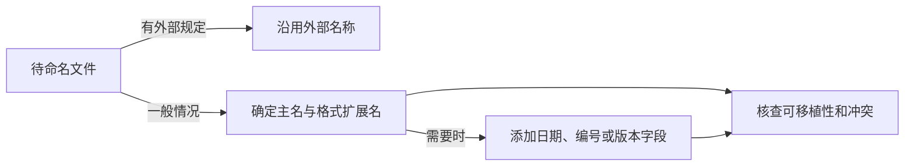

# `File naming protocol`

`Status` `Proposed`

## `Scope`

本仓库自有的文件名，包括文档、数据与研究产物。[路径可移植性规则](#path-portability)也适用于目录名。



## `Rules`

1. 普通文件的主名使用小写 `ASCII` 字母、数字和连字符。需要区分语义字段时，以 `__` 分隔。
2. 采用在所在目录内简短且明确的名称，省略路径中已经表达且不会造成歧义的信息。
3. 可参考 `subject__type__qualifier.ext`，保留识别文件所需的字段。字段的含义由上下文决定。需要无歧义地解析字段时，将其含义记录为结构化的 [`Metadata`](../dictionary/engineering-terms.md#metadata)。
4. 扩展名应使用与实际格式相符的小写形式。按格式惯例使用复合扩展名（如 `.tar.gz`）或省略扩展名。
5. 日期字段使用有效的日历日期，写作 `YYYY-MM-DD`。定宽编号在同一集合中使用约定的位数，如 `001`。何时将日期或版本放入文件名由[版本管理协议](versioning.md)规定。

普通非隐藏文件名的字符和分隔符可用下式检查。

```regex
^[a-z0-9]+(?:-[a-z0-9]+)*(?:__[a-z0-9]+(?:-[a-z0-9]+)*)*(?:\.[a-z0-9]+(?:-[a-z0-9]+)*)*$
```

此表达式只检查字面形式。文件的主名、版本字段和实际格式扩展名须结合上下文判断。[`Exceptions`](#exceptions)

### `Path portability`

- 路径的各级名称应避开空格、控制字符、`Windows` 保留字符和设备名。附有扩展名的设备名（如 `NUL.txt`）仍属保留名称。名称末尾应避开句点。参见 [`Windows` 文件和目录命名文档](https://learn.microsoft.com/en-us/windows/win32/fileio/naming-a-file#naming-conventions)。
- 同一目录下的文件和子目录名称应在忽略大小写后仍可区分。保持路径简短，并核对目标平台和工具的长度限制。

## `Exceptions`

- 外部工具规定的文件名或标识符形式优先，例如 `.gitignore`、`.gitattributes` 和可导入的 `Python` 模块名。第三方文件保留原名。
- 根目录治理与导航文档采用以下明确例外：`README.md`、`AGENTS.md`、`ARCHITECTURE.md`、`SPECIFICATION.md`、`CHANGELOG.md`、`ROADMAP.md` 和 `VERIFICATION.md`。
- 对外分发文件可在主名末尾追加用 `__` 分隔的版本字段，字段内允许使用句点。例如，`engineering-dictionary__v1.0.0.zip` 的版本字段是 `v1.0.0`，实际格式扩展名为 `.zip`。

## `Examples`

| 推荐名称 | 应避免的名称 | 理由 |
| --- | --- | --- |
| `coefficient-matrix.json` | `Coefficient Matrix FINAL.json` | 名称稳定且便于跨平台使用 |
| `sample__readings__raw.csv` | `data1.csv` | 字段能表达文件用途 |
| `2026-11-26__meeting.md` | `11-26-26 notes.md` | 日期明确且可以按文本排序 |
| `experiment-001.json` | `experiment 1.json` | 定宽编号便于排序 |
| `device-log.txt` | `NUL.txt` | 避开保留设备名 |

## `Verification`

核对适用的命名例外、保留名称、大小写冲突和目录内的可辨识性。另行核对日历日期、实际文件格式和语义字段。修改现有文件名时，应依据维护授权，并同步更新受影响的引用或维持兼容路径。
