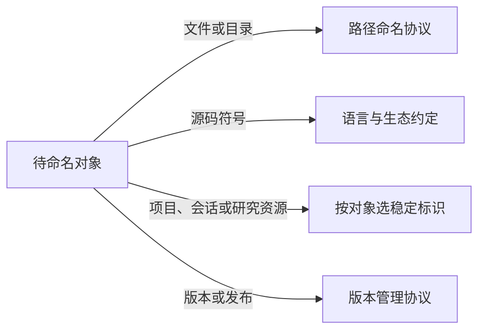

# `Naming conventions`

`Status` `Proposed`

## `Scope`

项目、仓库、源码标识符、智能体、会话及研究资源的名称。

## `Rules`

| 对象 | 约定 |
| --- | --- |
| 项目、仓库 | 路径标识使用简短的 `kebab-case`。可读标题可另行记录。 |
| 变量、函数、类、模块、包 | 遵循语言和生态约定。名称表达用途，保持公开标识符稳定。 |
| 智能体、会话 | 名称表达职责或任务。需要稳定引用时采用宿主提供的标识，展示名称可以更新。 |
| 实验、数据集、研究产物、验证证书 | 标识在所属项目内稳定，来源与关联记录存入元数据。路径按文件和目录协议命名。 |
| 版本、发布 | 使用版本协议规定的标识与追溯规则。 |

路径及发布规则分别见 [`File naming`](file-naming.md)、[`Directory naming`](directory-naming.md) 和 [`Versioning`](versioning.md)。

## `Exceptions`

生态规定的标识、工具文件和既有外部标识优先，例如 `pyproject.toml`。改动公开名称前先核查调用者及引用。

## `Examples`

| 用途 | 合适示例 | 应避免 |
| --- | --- | --- |
| 仓库 | `engineering-dictionary` | `Engineering Dictionary FINAL` |
| 源码符号 | 在项目惯例为蛇形命名时使用 `load_dataset` | 为统一文件风格将函数命名为 `load-dataset` |
| 智能体与会话 | `Document reviewer`、`Review naming protocol` | `Agent 1`、`Untitled` 作为长期引用 |
| 实验、数据及证书 | `experiments/001/results.csv`、`equations__certificate.json` | `experiments/experiment-001/experiment-001-results.csv`、`certificate-final.json` |

## `Verification`

按对象类型检查所属命名规则，核对标识是否唯一、稳定并能解析到对象。路径检查采用相应命名协议，公开源码标识通过已有调用和生态规则核对。
