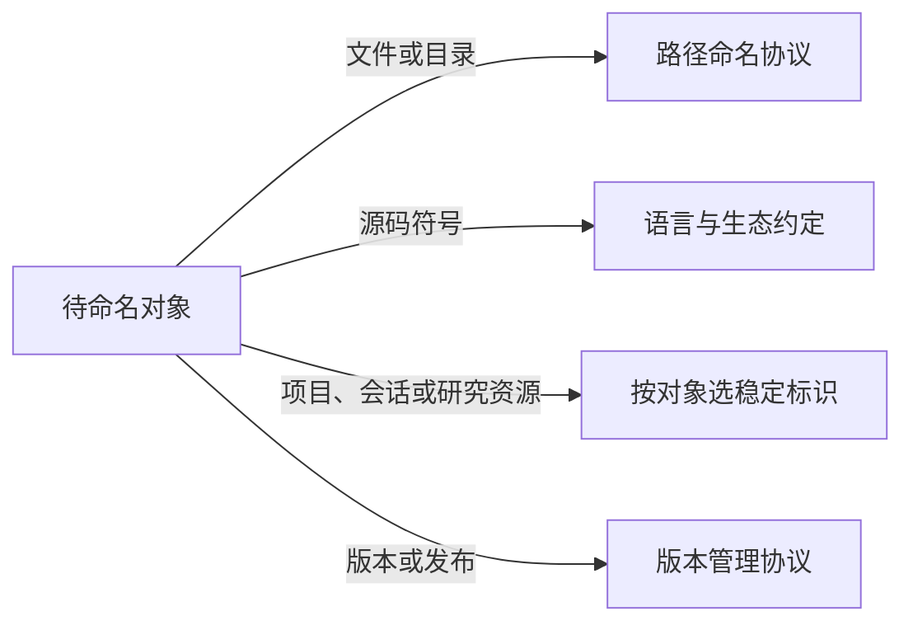

**Email:** bojue.math@gmail.com\
**Version:** 1.0.0\
**Last Updated:** 2026-11-28

# `Naming conventions`

`Status` `Proposed`

作者邮箱 `bojue.math@gmail.com`

## `Scope`

项目、仓库、源码标识符、智能体、会话及研究资源的名称。

## `Rules`

| 对象 | 约定 |
| --- | --- |
| 项目、仓库 | 路径标识使用简短的 `kebab-case`。可读标题可另行记录。 |
| 变量、函数、类、模块、包 | 遵循语言和生态约定。名称表达用途，保持公开标识符稳定。 |
| 智能体、会话 | 名称表达职责或任务。需要稳定引用时采用宿主提供的标识，展示名称可以更新。 |
| 实验、数据集、研究产物、验证证书 | 标识在所属项目内稳定，来源与关联记录存入元数据。路径按文件和目录协议命名。 |
| 版本、发布 | 使用版本协议规定的标识与追溯规则。 |

路径及发布规则分别见 [`File naming`](file-naming.md)、[`Directory naming`](directory-naming.md) 和 [`Versioning`](versioning.md)。

文档需要标明受众时，可按[文件命名协议](file-naming.md#exceptions)使用已登记的限定字段。`__` 分隔文档族与受众。

## `Exceptions`

生态规定的标识、工具文件和既有外部标识优先，例如 `pyproject.toml`。改动公开名称前先核查调用者及引用。

## `Examples`

| 用途 | 合适示例 | 应避免 |
| --- | --- | --- |
| 仓库 | `engineering-dictionary` | `Engineering Dictionary FINAL` |
| 源码符号 | 在项目惯例为蛇形命名时使用 `load_dataset` | 为统一文件风格将函数命名为 `load-dataset` |
| 智能体与会话 | `Document reviewer`、`Review naming protocol` | `Agent 1`、`Untitled` 作为长期引用 |
| 实验、数据及证书 | `experiments/001/results.csv`、`equations__certificate.json` | `experiments/experiment-001/experiment-001-results.csv`、`certificate-final.json` |
| 人类项目入口 | `README.md` | 把维护操作集中写入首页 |
| 智能体项目上下文 | `README__agents.md` | `README-agents.md` |
| 智能体操作指令 | `AGENTS.md` | 用上下文文档代替标准指令入口 |

## `Verification`

按对象类型检查所属命名规则，核对标识是否唯一、稳定并能解析到对象。路径检查采用相应命名协议，公开源码标识通过已有调用和生态规则核对。

## `Naming by example`

先读一个完整路径 `experiments/001/sensor-readings__raw.csv`。`experiments/001/` 给出实验位置，`sensor-readings` 说明内容，`__raw` 标记原始数据，`.csv` 表示文件格式。

### 大小写

| 写法 | 示例 | 何时用 |
| --- | --- | --- |
| `kebab-case` | `sensor-readings.csv`、`data-processing/` | 本仓库普通文件和目录默认使用小写，单词间用连字符。 |
| 固定大写名称 | `README.md`、`AGENTS.md` | 沿用约定的文件名。 |
| `snake_case` | `load_data.py`、`load_data()` | 可用于遵循这种惯例的源码模块、变量或函数。 |
| `camelCase` / `PascalCase` | `loadData()` / `DataLoader` | 前者首词小写，后者每个词的首字母大写。具体用在什么对象上由语言和项目决定。 |

同一目录避免只靠大小写区分文件，例如同时使用 `results.csv` 和 `Results.csv`。

### 符号

| 符号 | 用途 | 示例 |
| --- | --- | --- |
| `-` | 连接同一字段内的单词，也用于日期或编号。 | `sensor-readings`、`2026-11-26`、`experiment-001` |
| `_` | 连接采用 `snake_case` 的源码标识中的单词。 | `load_data.py` |
| `__` | 可选，用于分隔含义不同的文件名字段。 | `sensor-readings__raw.csv` 中连接内容名和数据阶段。 |
| `.` | 引出扩展名。约定名称中的前导点另有用途。 | `.csv`、`.tar.gz`、`.gitignore` |
| `/` | 在文档和链接中分隔目录层级。 | `experiments/001/results.csv` |
| 空格、`#`、`%` | 普通文件名避免使用，便于输入和引用。 | 用 `daily-report.md` 代替 `Daily Report #1.md`。 |
| `:`、`?`、`*` 等 | 属于跨平台文件路径应避开的字符。 | 用 `run-01.csv` 代替 `run:01.csv`。 |

### 扩展名与后缀

| 类型 | 示例 | 表达什么 |
| --- | --- | --- |
| 文件扩展名 | `notes.md`、`results.csv`、`metadata.json` | 分别表示 Markdown 文档、逗号分隔表格、JSON 数据。 |
| 复合扩展名 | `dataset.tar.gz` | `.tar` 表示归档，`.gz` 表示用 gzip 压缩。 |
| 用途或阶段后缀 | `readings__raw.csv`、`readings__cleaned.csv`、`equations__certificate.json` | `raw`、`cleaned`、`certificate` 分别说明原始数据、清洗结果、证书。字段含义由项目约定，放在扩展名之前。 |
| 日期和编号 | `2026-11-26__meeting.md`、`experiment-001.json` | 日期表示记录所属日期，`001` 是定宽编号。 |
| 版本后缀 | `engineering-dictionary__v1.0.0.zip` | `v1.0.0` 标识分发版本，`.zip` 说明归档格式。 |

**练习。** 实验 `001` 的清洗结果是一张 CSV 表。可以命名为 `experiments/001/sensor-readings__cleaned.csv`。目录已给出实验编号，文件名只需说明内容和处理阶段。
