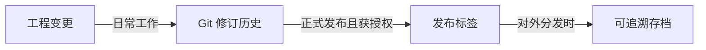

**Email:** bojue.math@gmail.com\
**Version:** 1.0.0\
**Last Updated:** 2026-11-28 00:32:05

# `Versioning protocol`

`Status` `Proposed`

## `Scope`

本仓库的文档修订版本、`Git` 修订历史、发布标签以及按日期或发布版本标识的记录和存档。

## `Rules`

- 日常工作文件保持稳定的文件名，通过 `Git` 记录修订历史。经授权提交时，将相关修改归入同一提交，并用简短明确的提交说明记录变更。
- 正式创建发布版本时才使用发布标签（如 `v1.0.0`）。记录可追溯的发布标识与来源，可使用变更日志或 [`Manifest`](../dictionary/engineering-terms.md#manifest)。避免使用 `final`、`final2` 或 `latest` 作为固定的来源标识。
- 创建提交、添加发布标签、推送或发布均需维护者授权。
- 发布标识符用于追溯版本。采用 `Semantic Versioning 2.0.0` 须先声明公开的 `API`，再按照该规范管理版本。当前协议将其作为外部参考。参见[规范原文](https://semver.org/)。

### `Document revision version`

文档首次记录版本时使用 `1.0.0`。版本采用 `MAJOR.MINOR.PATCH` 数字格式，各字段使用不补零的十进制整数。每次修改文档时，用实际修改的当地日期和时间更新 `Last Updated`，并比较更新前后的日期部分，按以下优先级更新版本。

1. 跨月（含跨年）时，`MAJOR` 加 `1`，`MINOR` 和 `PATCH` 归零。
2. 同月跨周时，`MINOR` 加 `1`，`PATCH` 归零。每月 `1` 至 `7` 日为第一周，此后每七天进入下一周。
3. 同周跨日时，`PATCH` 加 `1`。
4. 同日修改时，保留版本号。

每次更新最多递增一个字段，跳过的月、周或日不补计。例如，首次记录于 `2026-11-27` 的文档为 `1.0.0`，随后在 `11-28`、`11-29` 和 `12-01` 更新，版本依次为 `1.0.1`、`1.1.0` 和 `2.0.0`。

查阅具体修订时结合 `Last Updated` 和 `Git` 修订历史。该版本号用于[文档页首](../SPECIFICATION.md#document-layout)，发布标签仍遵循本协议的发布规则。

## `Exceptions`

- 按时间索引的记录使用日期。对外分发的快照或不可变产物需要独立标识时，可在文件名中保留发布版本。日期与版本字段的写法见[文件命名协议](file-naming.md)。

## `Examples`

| 资源 | 示例 |
| --- | --- |
| 日常维护的协议 | `file-naming.md` |
| 发布标签 | `v1.0.0` |
| 对外分发的存档 | `engineering-dictionary__v1.0.0.zip` |
| 按日期索引的会议记录 | `2026-11-26__meeting.md` |

应避免用 `report-final2.md` 表示可追溯版本，也应避免为日常修订随意创建发布标签。

## `Verification`

核对发布标签指向预期的 `Git` 提交，存档标识能追溯到对应版本，按日期索引的记录日期有效。发布前确认已获授权，并在使用兼容性版本规则时核对已声明的接口和实际变更。
