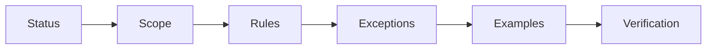

页码 1/1\
时间戳 `<YYYY-MM-DDTHH:mm:ss±HH:mm>`\
版本 `v1.0.0`

# `Protocol name`

`Status` `Proposed`

将标题替换为英文协议名称。状态使用 `Proposed`、`Adopted` 或 `Deprecated` 中与实际情况对应的一个值。

按[文档排版规范](../SPECIFICATION.md#document-layout)填写页首字段。

## `Scope`

说明协议适用的资源、角色或操作。

## `Rules`

依据[规范](../SPECIFICATION.md)说明要求、建议和可选项。注明规则来自本仓库约定、通行做法或可核实的外部标准。

## `Exceptions`

列出例外及其适用条件，或明确说明是否存在例外。

## `Examples`

给出符合规则的实例。在有助于理解时，同时给出违反规则的实例并说明原因。

## `Verification`

说明如何检查规则是否满足，以及各检查方法的适用范围。
